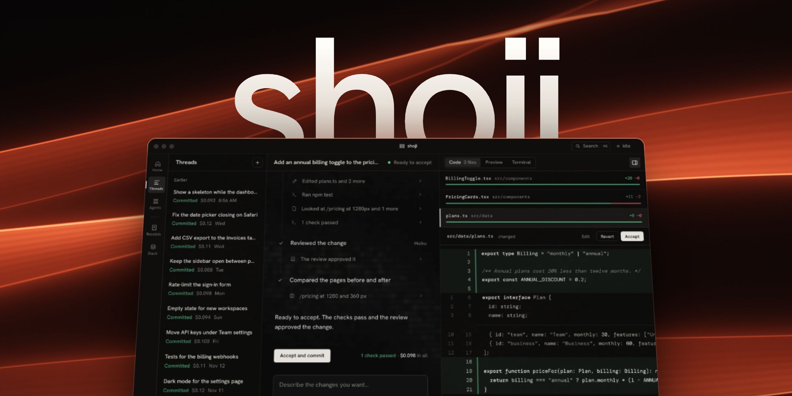
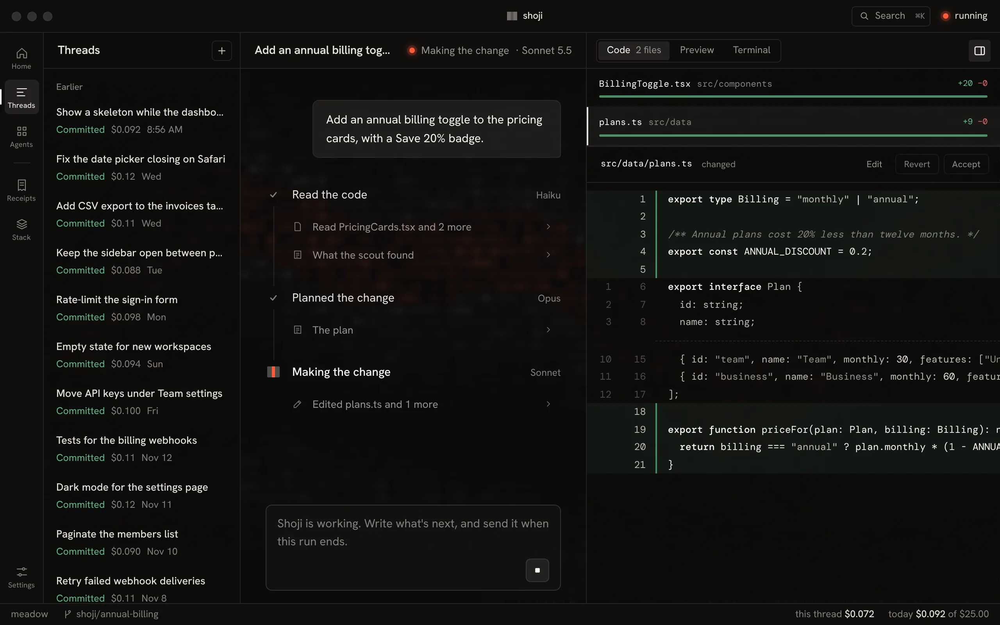
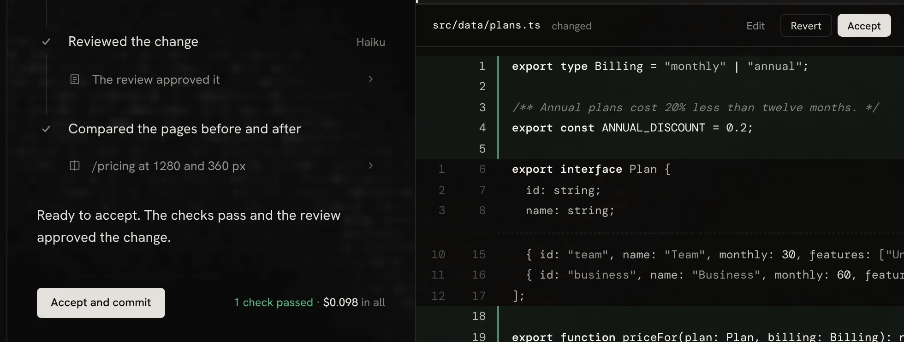
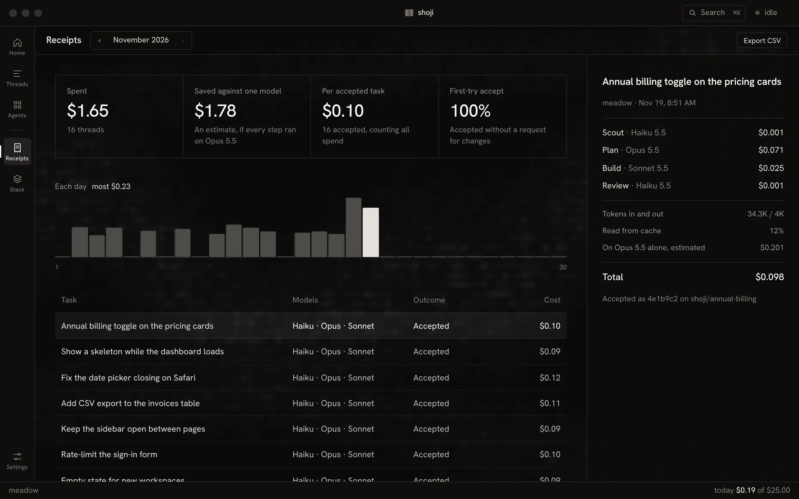
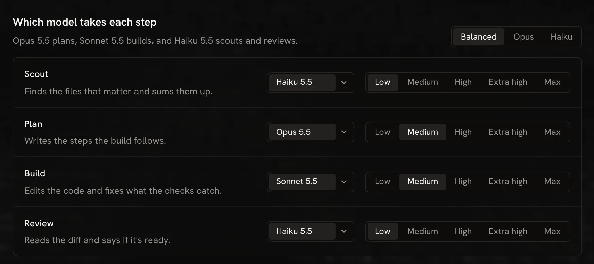
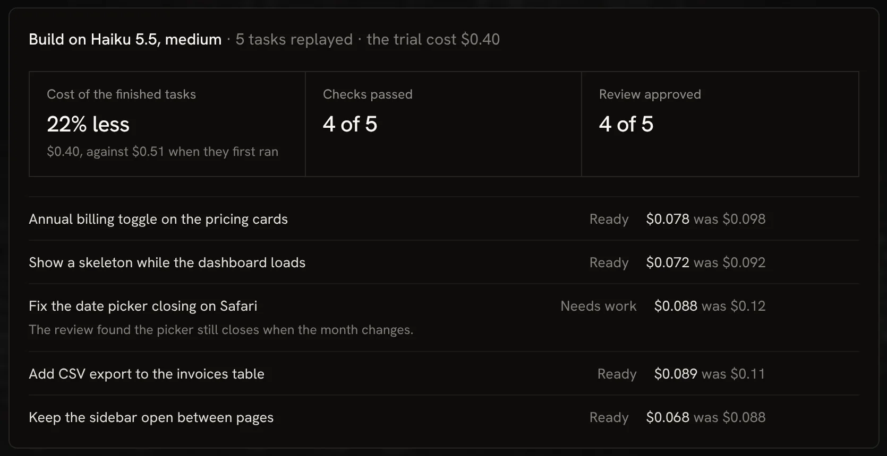
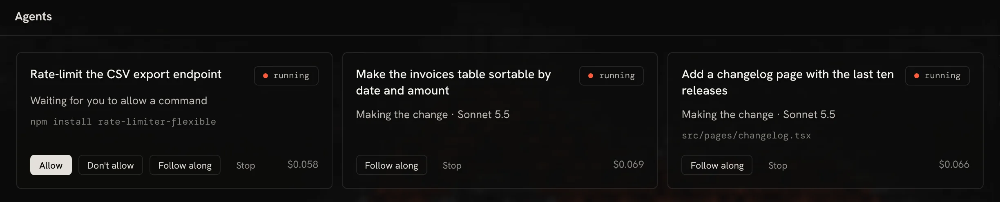
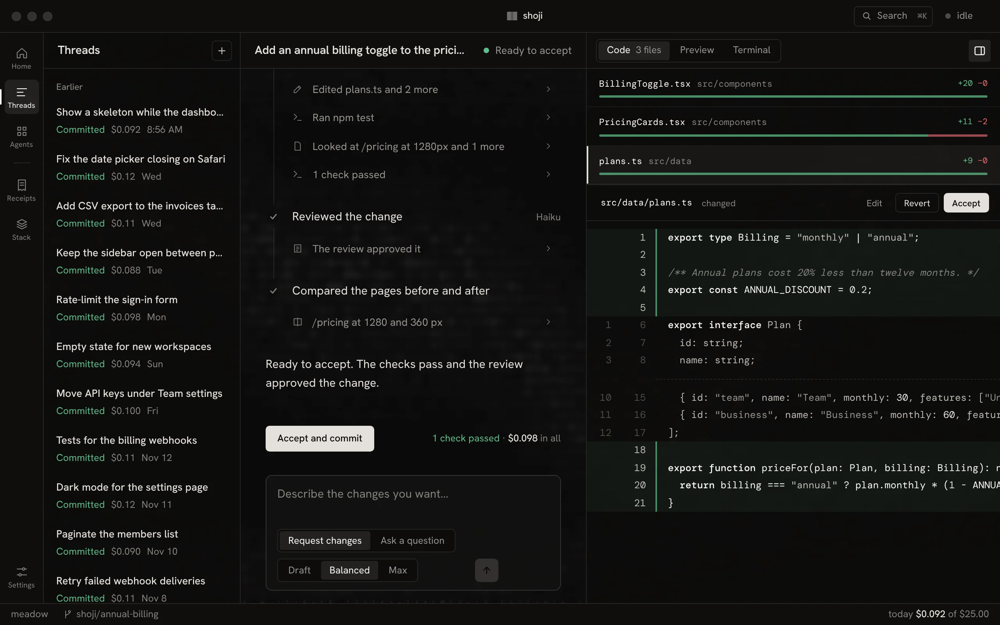
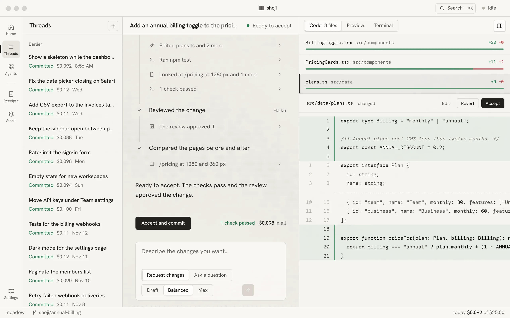

<p align="center">
  <a href="https://shoji-app.vercel.app/"></a>
</p>

<h3 align="center">The right model for every step.</h3>

<p align="center">
  A free desktop app for building software with AI. You describe a change, and a small team of models plans it, builds it and checks it, each one chosen for its step.
</p>

<p align="center">
  <a href="https://github.com/FLX-2/shoji/releases/latest"><b>Download</b></a>
  &nbsp;·&nbsp;
  <a href="https://shoji-app.vercel.app/">Website</a>
  &nbsp;·&nbsp;
  <a href="https://youtu.be/qsCWjtK_kMI">Watch the film</a>
  &nbsp;·&nbsp;
  <a href="docs/guide.md">Guide</a>
</p>

<p align="center">
  <sub>macOS (Apple silicon) · Windows · Linux &nbsp;|&nbsp; Anthropic, OpenAI, ChatGPT, OpenRouter or Ollama &nbsp;|&nbsp; MIT license</sub>
</p>

<br>

## How it works

A change is a series of steps. Shoji gives each step the model that suits it. The strong model plans, where judgment matters. Faster, cheaper models read, build and review.

| Step | What it does | Model | Cost |
| --- | --- | --- | ---: |
| **Scout** | Finds the files that matter and sums them up. | Haiku 5.5 | $0.001 |
| **Plan** | Writes the steps the build follows. | Opus 5.5 | $0.071 |
| **Build** | Edits the code, runs your tests and fixes what they catch. | Sonnet 5.5 | $0.025 |
| **Review** | Reads the diff and says if it's ready. | Haiku 5.5 | $0.001 |
| **You** | Accept it. Nothing is committed until you do. | | **$0.098** |

<sub>One sample task: an annual billing toggle on a pricing page. Change any role's model in Stack.</sub>

In a test on six real tasks in October 2026, routing each step this way cost 55% less per accepted change than running every step on Opus 5.5, and all six were accepted, the same as Opus alone.

## Every step in view

The conversation shows each step as it runs, with its model, its work and what it has cost so far. The code opens beside it the moment a file changes.



- **Code:** every changed file with its diff. Comment on a line, then send your notes as one request for changes.
- **Preview:** your dev server at 360, 768 or 1280 px, showing this thread's work.
- **Terminal:** your own shell, in the thread's copy of the project.

Ask a question at any point. Scout reads the code and answers in the thread, and nothing in the project changes.

## Nothing is committed until you accept it

Each thread works on its own branch, in its own copy of your project, so your checkout stays as it was. Accept or revert file by file, then commit the rest under your own git name. Shoji never pushes on its own. When you're ready, Push and open PR takes you to the pull request.



## Every task leaves a receipt

The model behind each step and what it cost, set against running every step on one strong model. Export any month as CSV.



## Your stack, your call

Choose the model and effort for each role, or start from Balanced. The choice is saved to `stack.lock` with its history, so you can see what changed and when.



Before you switch, try the new stack on work you've already accepted.

- **Trial** replays your latest accepted tasks on another stack, in scratch copies of your project, and tells you what changed.
- **Watching** compares each model's week with the four before, and names one that got slower, dearer or worse at its role.
- **New models** arrive with the model list, which updates once a day, so a new model needs no new release. You decide when to trial it.



## Several threads at once, and a limit that holds

Every thread has its own branch and copy, so threads never step on each other. A role can run your project's checks at any time. Any other command, like installing a package, waits for you to allow it once, always for that project, or not at all.



Each thread has a spending limit, and Shoji stops before any call that could pass it. A daily limit asks before a new thread could take the day past it.

## Fits the way you already work

- **Commands and skills.** Reads the same files Claude Code does: your commands, your skills, `AGENTS.md` and `CLAUDE.md`.
- **MCP servers.** Paste a server's JSON. Tools that could change something wait for you, like commands.
- **Pages it can see.** Build opens your page in a headless browser at 360, 768 or 1280 px and checks what it shows.
- **Check the plan first.** Pause after the plan, then build it or ask for another.
- **Draft, Balanced, Max.** Set what a task is worth. Draft moves steps down a model; Max puts Build on the plan model.
- **Attach anything.** Point at a file with @, or attach screenshots, PDFs and text.
- **Scheduled tasks.** Run a task every day, on weekdays or weekly, inside your daily limit.
- **Push and open PR.** Pushes the thread's branch with your own git sign-in, then opens the pull request page.

The [guide](docs/guide.md) covers each of these in detail.

## Darkroom or paper

A darkroom theme, and a paper one like the screens the app is named for. Every effect, motion and accent can be turned off in Settings.

<table>
  <tr>
    <td width="50%"></td>
    <td width="50%"></td>
  </tr>
</table>

## Your data

Your code goes to the model, and nowhere else.

- **Your keys stay in the keychain.** Shoji sends each only to its own provider.
- **A model sees only what it needs.** Only the files a role reads or you attach go to the provider.
- **Private files never go at all.** `.env` files and keys are off limits to every role. Add your own patterns in Settings.
- **No account, no server.** Receipts and run logs stay on your computer. Shoji sends no usage data.

Once a day Shoji downloads the list of models and their prices from this repository ([`catalog/v2/models.json`](catalog/v2/models.json)), and when it opens it asks this repository's releases whether a newer Shoji is out. Neither carries anything about you or your work, and you can turn each off in Settings. More in the [guide](docs/guide.md#your-data).

## Install

Download the installer for your system from the [latest release](https://github.com/FLX-2/shoji/releases/latest).

| System | Download |
| --- | --- |
| macOS 12 or later, Apple silicon | `.dmg` |
| Windows 10 or 11 | `.exe` or `.msi` installer |
| Linux | `.AppImage` or `.deb` |

The builds aren't signed yet, so your system asks once before opening one.

- **Mac:** the first time, Control-click the app and choose Open. If macOS still blocks it, allow it under System Settings, Privacy & Security.
- **Windows:** if SmartScreen stops the installer, choose More info, then Run anyway.

Shoji is free. You pay for the models your tasks use, with your own API key from Anthropic, OpenAI or OpenRouter. With ChatGPT Plus or Pro you can sign in instead and run OpenAI's models on your plan, and with [Ollama](https://ollama.com) models run free on your computer. The first time Shoji opens, one Welcome page connects Anthropic, your ChatGPT plan or Ollama, picks a starting stack and opens a project. A project must be a git repo with at least one commit.

## Build from source

You need [Node 22](https://nodejs.org), [pnpm](https://pnpm.io), [Rust](https://rustup.rs) and [Bun](https://bun.sh), which compiles the agent runtime that the app bundles, plus the [Tauri prerequisites](https://v2.tauri.app/start/prerequisites/) for your system:

- **Mac:** the Xcode Command Line Tools (`xcode-select --install`).
- **Windows:** the Microsoft C++ Build Tools and WebView2, which Windows 10 and 11 already include.
- **Linux:** the Tauri system libraries, including `libwebkit2gtk-4.1-dev`, and `libdbus-1-dev` for the keychain.

```sh
git clone https://github.com/FLX-2/shoji.git
cd shoji
pnpm install
pnpm tauri dev
```

| Command | What it does |
| --- | --- |
| `pnpm tauri dev` | Runs the app with live reload |
| `pnpm test` | Runs the tests. They replay recorded model answers and never call a model |
| `pnpm typecheck` | Checks types |
| `pnpm tauri build` | Builds the installable app for this computer |

The agent runtime in `runtime/` also runs on its own, on any git project. See [the guide](docs/guide.md#the-agent-runtime-on-the-command-line).

## Status

Shoji 0.2 adds more models: OpenAI's with an API key or your ChatGPT plan, hundreds more through OpenRouter, and local models with Ollama. Review now judges the look of the pages Build changed, and first run is a single Welcome page. Mac comes first, and Windows and Linux build from the same code on every change.

Found a bug or want something? [Open an issue](https://github.com/FLX-2/shoji/issues/new/choose). To work on Shoji itself, read [CONTRIBUTING](CONTRIBUTING.md).

## License

[MIT](LICENSE). The screens in this README are the real app working on a sample project, so their numbers are sample data.
